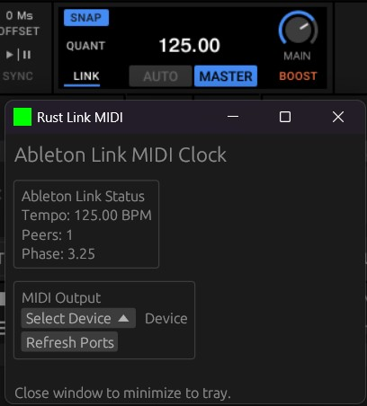

# Rust Ableton Link → MIDI Clock

> ⚠️ **Warning — AI-generated code**: This project is AI slop and shouldbe avoided. But maybe it's inspires you.

A small Rust app that bridges Ableton Link to a MIDI Clock output (sends `0xF8` ticks at 24 PPQN). Use it to sync external hardware or software to Ableton Link sessions. For example Traktor to a stable midi clock, as Traktor midi clock is unstable.

---

## Screenshot

---

## Quickstart

- Build: `cargo build --release`
- Run: `cargo run` (or execute the compiled binary in `target/release`)
- In the UI: select a MIDI output device and the app will send MIDI clock ticks synced to Ableton Link.

## Notes

- This project is a developer utility / prototype. There is minimal error handling and the CLI/UI is basic.
- See `.github/todo.md` for short-term tasks and planned improvements.
- The code was partially generated with AI assistance — review carefully before using in critical setups.
